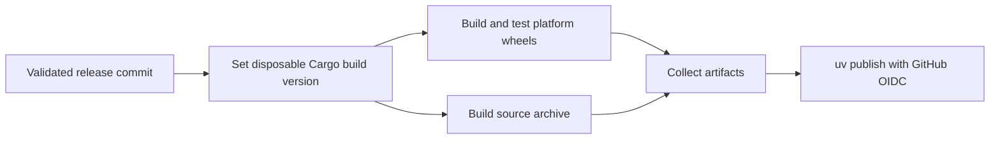

# changenote Python distribution

Distribute the Rust changenote CLI as a Python package. The package uses [maturin](https://www.maturin.rs/) with `bindings = "bin"`, like [uv's Python distribution](https://github.com/astral-sh/uv/tree/main/python/uv).

The PyPI distribution, executable, and Python module names are `changenote`. The module is in `python/changenote`, with package metadata in root `pyproject.toml`; Python does not use a uv workspace. Python wrapper changes use the `changenote` release name in `.changenote/config.json`; the wrapper has no independent version file or release plan. CLI logic stays in `crates/changenote/src/`, the only member of the root Cargo workspace.

## Run with uvx

After this binary-wrapper version is published to the existing [changenote PyPI project](https://pypi.org/project/changenote/) with a wheel for your platform:

```sh
uvx changenote --help
uvx changenote status
```

The Release workflow publishes this binary-wrapper distribution after the PyPI project's GitHub Trusted Publisher is configured. To test a local wheel, run from the repository root:

```sh
uv build --out-dir dist/python-binary
uvx --isolated --no-index --find-links dist/python-binary changenote --help
```

A wheel contains the compiled Rust executable and does not require a Rust toolchain at runtime. A source installation requires Rust and Cargo. Each wheel supports its target platform; a local build does not produce wheels for all platforms.

## Development

Run from the repository root:

```sh
uv sync --locked
uv run --locked changenote status
uv run --locked python -m changenote --help
uv run --locked python -m unittest discover -s python/tests
```

The optional Python module runner finds the installed binary and passes arguments, the working directory, and the environment to it. It preserves the executable's exit code. It does not download a binary or use a system executable from `PATH`.

uv cache keys include the nested Rust sources, both Cargo manifests, root lockfile, canonical `skills/changenote/SKILL.md`, and package-local `crates/changenote/assets/changenote.SKILL.md`.
Keep the package-local skill byte-identical to the canonical file; publication tests check both copies.
Changes to these files cause local package rebuilds.
`uv build` produces a source distribution and builds a wheel from it, including the workspace manifest, member sources, shared lockfile, and bundled skill.
Run `uv run --no-project python -m unittest discover -s tests/distribution -v` from the repository root to verify separate Cargo archive and Python sdist installations in temporary directories. These checks do not upload artifacts.

The Python distribution uses `dynamic = ["version"]`: maturin reads the version directly from `crates/changenote/Cargo.toml`, selected by `tool.maturin.manifest-path`. The wheel metadata and the packaged CLI's `--version` therefore use the same Rust crate version; do not add a separate Python manifest version.

Release notes are collected under `changenote`, with the changelog at root `CHANGELOG.md`. The current single release package uses `v<version>` tags. The release version source is `crates/changenote/Cargo.toml`; `changenote version` also synchronizes the existing root `Cargo.lock`. The release package stays rooted at `.` so Python changes remain in its note-check coverage. For manual publication, update the Rust crate version and lockfile first. Use a version that is not already published on PyPI.

## Automated publication

The repository's `.github/workflows/release.yml` uses the same core approach as uv: maturin Action builds distributions, and `uv publish --trusted-publishing always` uploads them with GitHub OIDC. Only the upload job has `id-token: write`; the wheel-build jobs cannot request OIDC tokens. No PyPI token secret is read.



Supported wheels:

- Linux x86_64 and aarch64, built in manylinux 2.17 containers.
- macOS x86_64 and aarch64.
- Windows x86_64.

Each wheel is installed and its CLI version is checked on its native runner. One Linux job also builds the source archive. Alpine/musl wheels and Windows ARM64 wheels are not included.

Builds use the release commit returned by the publication Action, not the latest main tree. The preparation script from the workflow revision checks the configured version source against the saved batch and validates the local package version in `Cargo.lock`. Current releases use `crates/changenote/Cargo.toml` and need no build-only version changes. Preparation also supports historical root `Cargo.toml` sources. Older releases configured with root `VERSION` receive root Cargo package version synchronization in a disposable checkout. Dependency versions and committed release files are unchanged. Wheel metadata and the CLI version must match the validated release version.

Before enabling uploads:

1. Create the GitHub environment `pypi`. Restrict deployments to `main`; add required reviewers if approval is needed.
2. In the existing PyPI `changenote` project's **Publishing** settings, add a GitHub [Trusted Publisher](https://docs.pypi.org/trusted-publishers/adding-a-publisher/).
   - Set the owner to `changenote`.
   - Set the repository to `changenote`.
   - Set the workflow filename to `release.yml`, not its path or display name.
   - Set the environment to `pypi`.
3. Complete the publisher configuration before merging the OIDC workflow change. A project owner must verify these account settings; local tests cannot verify them. Uploads fail if the publisher is absent or does not match. There is no token fallback.
4. Confirm that the next release version is unused on PyPI. Keep environment branch restrictions and any required approvals in place. Remove an old `PYPI_TOKEN` secret after a separately authorized publication confirms the new authentication path.

Ordinary pushes to `main` only manage the Release PR. A confirmed merged managed Release PR starts automatic publication. Manual **Release** dispatch defaults to `operation=manage-pr` and does not publish.

After a partial failure, run **Release** on `main` with `operation=retry-publication`. This skips PR management and retries the latest validated batch. Wheel builds run even when the GitHub tag and Release already exist. `uv publish --check-url https://pypi.org/simple/` skips matching files that were already uploaded and rejects conflicting contents. A rebuilt artifact can differ from an earlier upload; inspect conflicts instead of replacing published files. Do not merge another Release PR until the current batch is fully published. The workflow discovers only the latest batch.

This package does not provide Python bindings to the Rust library.
