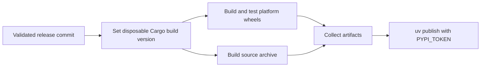

# changenote Python distribution

Distribute the Rust changenote CLI as a Python package. The package uses [maturin](https://www.maturin.rs/) with `bindings = "bin"`, like [uv's Python distribution](https://github.com/astral-sh/uv/tree/main/python/uv).

The PyPI distribution, executable, and Python module names are `changenote`. The module is in `python/changenote`, with package metadata in root `pyproject.toml`; Python does not use a uv workspace. Python wrapper changes use the `changenote` release name in `.changenote/config.json`; the wrapper has no independent version file or release plan. CLI logic stays in root `src/`.

## Run with uvx

After this binary-wrapper version is published to the existing [changenote PyPI project](https://pypi.org/project/changenote/) with a wheel for your platform:

```sh
uvx changenote --help
uvx changenote status
```

The Release workflow publishes this binary-wrapper distribution after its `PYPI_TOKEN` GitHub Actions secret is configured. To test a local wheel, run from the repository root:

```sh
uv build --out-dir dist/python-binary
uvx --isolated --no-index --find-links dist/python-binary changenote --help
```

A wheel contains the compiled Rust executable and does not require a Rust toolchain at runtime. A source installation requires Rust and Cargo. Each wheel supports its target platform; a local build does not produce wheels for all platforms.

## Development

Run from the repository root:

```sh
uv sync --locked
uv run --locked changenote status
uv run --locked python -m changenote --help
uv run --locked python -m unittest discover -s python/tests
```

The optional Python module runner finds the installed binary and passes arguments, the working directory, and the environment to it. It preserves the executable's exit code. It does not download a binary or use a system executable from `PATH`.

uv cache keys include the Rust sources and Cargo manifests, so Rust edits cause local package rebuilds. `uv build` produces a source distribution and builds a wheel from it, including the Rust package sources.

The Python distribution uses `dynamic = ["version"]`: maturin reads the version directly from root `Cargo.toml`. The wheel metadata and the packaged CLI's `--version` therefore use the same Rust crate version; do not add a separate Python manifest version.

Release notes are collected under `changenote`, with the changelog at root `CHANGELOG.md`. The current single release package uses `v<version>` tags. Changenote does not update committed Cargo files from root `VERSION`. For manual publication, make the Rust crate version match `VERSION` and update lockfiles first. Use a version that is not already published on PyPI.

## Automated publication

The repository's `.github/workflows/release.yml` uses the same core approach as uv: maturin Action builds distributions, and `uv publish` uploads them with the `PYPI_TOKEN` GitHub Actions secret.



Supported wheels:

- Linux x86_64 and aarch64, built in manylinux 2.17 containers.
- macOS x86_64 and aarch64.
- Windows x86_64.

Each wheel is installed and its CLI version is checked on its native runner. One Linux job also builds the source archive. Alpine/musl wheels and Windows ARM64 wheels are not included.

Builds use the release commit returned by the publication Action, not the latest main tree. The preparation script from the workflow revision checks the saved batch against `VERSION`, then sets only the root package versions in `Cargo.toml` and `Cargo.lock` in a disposable checkout. Dependency versions and committed release files are unchanged. Wheel metadata and the CLI version therefore match `VERSION`.

Before enabling uploads:

1. Create the GitHub environment `pypi`. Restrict deployments to `main`; add required reviewers if approval is needed.
2. Create a PyPI API token scoped to the existing `changenote` project. Store it as a GitHub Actions secret named `PYPI_TOKEN` in the `pypi` environment or repository.
3. Confirm that the next release version is unused on PyPI. The upload step passes the secret through `UV_PUBLISH_TOKEN` and disables Trusted Publishing. The upload job has only `contents: read` permission.

After a partial failure, rerun **Release** on `main`. Wheel builds run even when the GitHub tag and Release already exist. `uv publish --check-url https://pypi.org/simple/` skips matching files that were already uploaded and rejects conflicting contents. A rebuilt artifact can differ from an earlier upload; inspect conflicts instead of replacing published files. Do not merge another Release PR until the current batch is fully published. The workflow discovers only the latest batch.

This package does not provide Python bindings to the Rust library.
